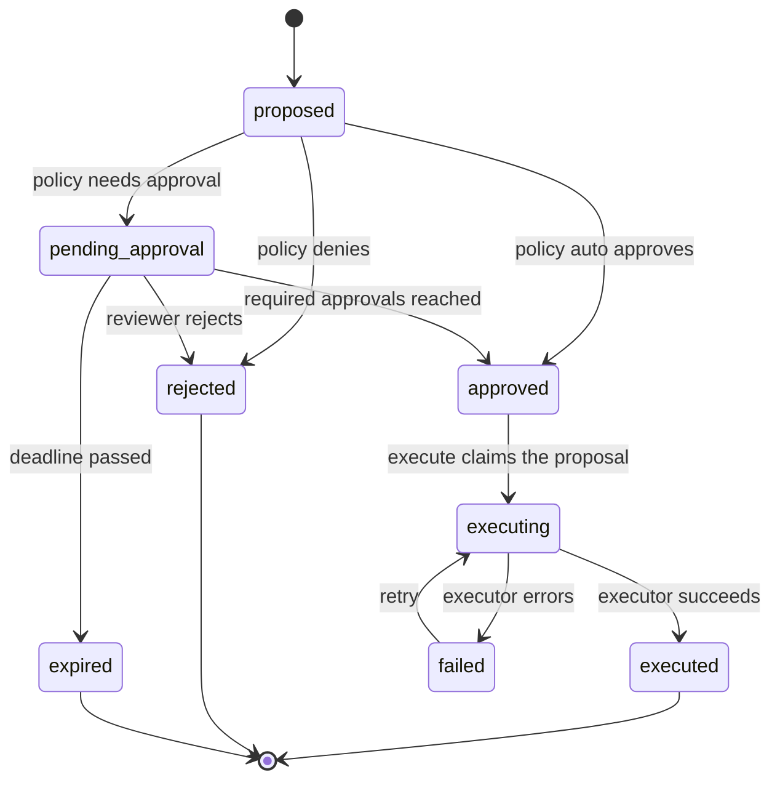
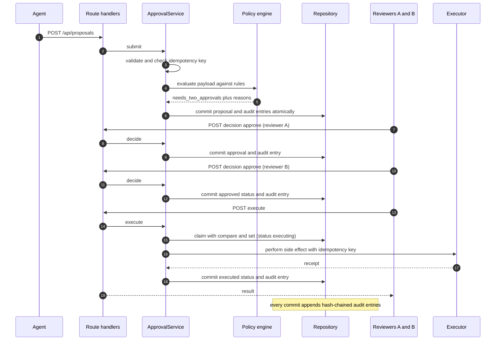

# Agent Approval Console

> An independent demonstration application, written from scratch; not extracted from any production system; all data synthetic. Built with AI coding assistance (Claude Code).

A human-in-the-loop **approval gate** for side-effecting actions proposed by AI agents, with a **tamper-evident audit trail**. Next.js (App Router) + TypeScript (strict) + Tailwind, with a framework-free, fully unit-tested domain core.

The scenario is the support desk of a fictional outdoor-gear retailer, "Larkspur Trail Supply". Support agents (simulated; there is no language model anywhere in this repo) propose refunds, account credits, customer replies and shipping-address changes. A risk policy decides what may proceed on its own, what needs one human approval, what needs two distinct approvers, and what is denied outright. Nothing happens until it is approved, and every step is recorded in a hash-chained log.

## The problem

An agent that can only *talk* is easy to supervise. An agent that can *act* (move money, send mail, change records) needs a control point between "the model decided" and "the system did it". Without one you get the usual failure modes: a hallucinated refund amount that nobody sees until the ledger is wrong; a double-click that pays twice; an agent approving its own work; an approval given for one payload and silently applied to another; and, afterwards, no trustworthy answer to "who allowed that, and on what basis?"

This project is a small, concrete implementation of that control point: **propose, evaluate, approve, execute, audit**, as separate steps with separate guarantees.

## What it demonstrates

- **Action proposals** with typed payloads, the agent's stated rationale, the originating ticket and a client-supplied idempotency key, validated by hand-written validators that return every problem with a precise path.
- **A risk policy engine whose rules are data**: outcome is `auto_approve`, `needs_approval`, `needs_two_approvals` or `deny`, each with a machine-readable reason code and a human-readable message. Strictest matching rule wins; no matching rule fails closed.
- **An explicit state machine**: `proposed → pending_approval → approved → executing → executed | failed`, plus `rejected` and `expired`. Illegal transitions throw. Stale pending proposals expire against an injectable clock.
- **Decisions**: approve, reject (reason required), and **edit-then-approve**, which records a field-level diff, re-evaluates policy on the edited payload, and invalidates earlier approvals of the old payload. The proposing agent cannot approve; one reviewer cannot supply both approvals of a two-approver action.
- **Idempotent execution**: a double click, a retry, or eight concurrent requests produce one simulated side effect. Executor failures are recorded and retryable.
- **An append-only audit log with a SHA-256 hash chain** (Node's built-in `crypto`) and a `verifyChain()` that pinpoints the first tampered entry. Refused decisions (for example an agent trying to approve) are audited too.
- **A repository port** with an in-memory implementation seeded with synthetic data, and a documented mapping for a Postgres implementation (not built).

## Architecture

```text
src/
  domain/     pure TypeScript: no React, no Next, no I/O. All the rules live here and are unit-tested.
  server/     thin Next-specific glue: the globalThis store, demo role handling, HTTP helpers.
  app/        App Router pages and route handlers (API).
  components/ UI components (server components by default; client only where interactive).
```

The dependency direction is one way: `app`, `components` and `server` depend on `domain`; `domain` depends on nothing but Node's `crypto`.

### Proposal lifecycle



### Propose, policy, approve, execute, audit



More detail, including the data model and how each guarantee is enforced, is in [`docs/design.md`](docs/design.md).

## Quickstart

Requires Node.js 20.19 or newer (developed on Node 22) and npm.

```bash
npm ci
npm run dev          # http://localhost:3000
```

Production build:

```bash
npm run build
npm start            # http://localhost:3000
```

Quality gates:

```bash
npm run lint
npm run typecheck    # generates Next route types, then runs tsc --noEmit
npm test             # Vitest unit tests for the domain core
```

No environment variables, database, or external service is needed. State is held **in memory** and is seeded with synthetic data at startup; it **resets whenever the server restarts**. It survives Next.js dev hot reloads because the store is a singleton on `globalThis`.

## Guided tour

1. Open the queue at `http://localhost:3000`. Note the **demo banner** and the role picker ("Acting as"): this is a stand-in for authentication, nothing more. Counts and chips filter by status and by risk.
2. Open a **High risk · 2 approvals** proposal. Read the policy explanation: each reason has a message and a machine-readable code. As Reviewer A, click **Approve**: it stays pending (1 of 2).
3. Click **Approve** again as Reviewer A. The server refuses it: the same reviewer cannot supply both approvals. Switch to **Reviewer B** and approve: now it is approved.
4. Click **Execute (simulated)**, then try **Send 2 simultaneous execute requests** on another approved proposal. The detail page shows the side effect happened once.
5. Open a pending proposal and use **Edit & approve…** to lower an amount. The page shows the field diff and how the policy outcome changed; earlier approvals of the old payload are marked "no longer counts".
6. Switch to **Agent** and try to approve something. The server returns 403 and the refusal appears in the timeline and audit log.
7. Use **Simulate agent** to generate fresh proposals. Try "Refund that fails once downstream": execution fails, the error is recorded, and **Retry execution** succeeds without duplicating the effect.
8. Open **Audit log**. Verification shows the chain is valid. Press **Simulate out-of-band tampering** and watch verification fail at the altered entry. **Reset demo data** restores the seed.

## HTTP API

All endpoints return JSON and `Cache-Control: no-store`. Errors look like `{ "error": { "code", "message", "issues?" } }`.

| Method and path | Purpose | Notes |
|---|---|---|
| `GET /api/proposals?status=&risk=&q=` | List and filter; includes counts | `risk` is a policy outcome |
| `POST /api/proposals` | Submit a proposal as an agent | 201 new, 200 if the idempotency key was already used with the same content, 409 if reused with different content |
| `GET /api/proposals/:id` | Proposal plus its timeline | |
| `POST /api/proposals/:id/decision` | `{ "decision": "approve" \| "reject" \| "edit_approve", ... }` | Needs a demo role |
| `POST /api/proposals/:id/execute` | Execute an approved proposal | Idempotent; `performed` is true only for the call that ran the executor |
| `GET /api/audit` | Audit entries and chain verification | |
| `POST /api/simulate` | Synthetic agent submits a proposal | `{ "scenario": "random" \| id }` |
| `POST /api/role`, `GET /api/role` | Demo role cookie | Demo only |
| `POST /api/demo/tamper`, `POST /api/demo/reset` | Demo controls | Demo only |

Example session (server running on port 3000). Endpoints that act as a person take the demo role from an `x-demo-role` header (or the `demo_role` cookie):

```bash
BASE=http://localhost:3000

# An agent proposes a $300 refund. It exceeds $250, so two distinct approvals are required.
curl -s -X POST "$BASE/api/proposals" -H 'content-type: application/json' -d '{
  "type": "issue_refund",
  "payload": { "orderId": "ORD-777002", "amountCents": 30000, "currency": "USD", "reasonCode": "not_as_described" },
  "rationale": "Customer says the jacket leaks; photos attached to the ticket.",
  "ticketId": "TKT-9002",
  "agentId": "agent:returns-assistant",
  "idempotencyKey": "readme-example-0001"
}'

# Use the id from the response (the first new proposal in a fresh server is PR-1013).
ID=PR-1013
curl -s -X POST "$BASE/api/proposals/$ID/decision" -H 'x-demo-role: reviewer_a' -H 'content-type: application/json' -d '{"decision":"approve"}'
curl -s -X POST "$BASE/api/proposals/$ID/decision" -H 'x-demo-role: reviewer_b' -H 'content-type: application/json' -d '{"decision":"approve"}'
curl -s -X POST "$BASE/api/proposals/$ID/execute"  -H 'x-demo-role: reviewer_a'   # performed: true
curl -s -X POST "$BASE/api/proposals/$ID/execute"  -H 'x-demo-role: reviewer_a'   # already_executed, performed: false
curl -s "$BASE/api/audit"                                                         # verification.valid: true
```

## Default policy

Defined as data in [`src/domain/policy-config.ts`](src/domain/policy-config.ts). The strictest matching rule wins.

| Action | Rule | Outcome |
|---|---|---|
| Refund | up to $50.00 | auto-approve |
| Refund | over $50.00 | one approval |
| Refund | over $250.00 | two distinct approvals |
| Refund | reason code `other` | one approval |
| Account credit | up to $25.00 / over $25.00 / over $100.00 | auto / one / two approvals |
| Customer reply | promises refunds or guarantees; legal or injury wording; asks for passwords, card numbers or one-time codes | one approval |
| Customer reply | none of the above | auto-approve |
| Shipping address | order not yet shipped | one approval |
| Shipping address | order shipped or delivered | **deny** |

## Design tradeoffs

- **Policy as data, not code.** Rules are plain objects (thresholds, field comparisons, regular-expression lists). They can be reviewed in a diff, versioned (`policyVersion` is stamped on every decision and audit entry), validated at load time, and loaded from storage, without touching the engine. The cost is a deliberately small expression language; anything it cannot say needs an engine change, which is the right pressure.
- **A framework-free domain core.** Every rule that matters (policy, state machine, two-approver logic, idempotency, audit chain) lives in `src/domain/` with no import of React or Next. It is testable in milliseconds with a manual clock, and it would survive a framework swap.
- **Idempotency in three layers.** (1) Submission: the same key plus the same content returns the original proposal; the same key with different content is a 409. (2) Claim: `execute` moves `approved → executing` with a compare-and-set on the proposal's version, so of N concurrent callers exactly one wins. (3) Downstream: the executor is handed the idempotency key and a well-behaved API deduplicates on it, covering the window where a call succeeds but its result is lost. The in-memory run proves layers 1 and 2 with concurrent-call tests; layer 3 is only simulated here.
- **Hash-chained audit versus a real WORM store.** The chain makes edits, deletions and reordering in the middle of the log detectable, at no infrastructure cost. It does **not** stop someone with write access from truncating the tail or rewriting the whole chain consistently; for that you need the head hash anchored somewhere the writer cannot alter (object-lock storage, a transparency log, a periodic signed checkpoint). The chain is a tamper-*evidence* mechanism, not tamper-*prevention*.
- **Edit-then-approve re-evaluates policy.** A reviewer who edits a payload is effectively authoring a new proposal. The edited payload is re-run through policy (it can become cheaper, costlier, or denied), approvals given to the old payload stop counting, and only the editor's approval carries over. Identifying fields (order, customer, currency, shipment status) are locked, so an edit cannot retarget the action or dodge a rule.
- **Execution is a separate step.** Approval does not run the side effect. Keeping "decided" and "done" apart is the point of the control, and it is what makes retries and failure recording well-defined.

## Status

| Capability | Status |
|---|---|
| Proposal validation, risk policy engine, state machine, decisions, edit-then-approve, expiry | Implemented and tested |
| Idempotent execution with failure recording and retry (including concurrent calls) | Implemented and tested |
| Hash-chained audit log with `verifyChain()` and tamper detection | Implemented and tested |
| In-memory repository with atomic commit and optimistic concurrency | Implemented and tested |
| Seeded synthetic data and the scenario generator | Implemented and tested |
| Route handlers and UI pages (queue, detail, audit, simulate) | Implemented; checked with one-off curl and browser runs during the build, not covered by automated UI or HTTP tests |
| Role switcher (agent, reviewer A, reviewer B, admin) | **Demo-only stand-in**: an unverified cookie or header, not authentication |
| "Agent" and its proposals | **Demo-only stand-in**: templates and a seeded random generator; no LLM |
| Executor | **Demo-only stand-in**: records a receipt in memory; calls nothing |
| Out-of-band tamper button and reset | **Demo-only stand-in** |
| Real authentication and authorization (identity, sessions, per-role permissions, agent credentials) | **Conceptual, not implemented** |
| Persistence (Postgres or any database); data survives restart | **Conceptual, not implemented** (see `docs/design.md`) |
| Real executors (payments, email, order system) | **Conceptual, not implemented** |
| External anchoring of the audit head hash / WORM storage | **Conceptual, not implemented** |
| Notifications, SLAs and escalation for pending items | **Conceptual, not implemented** |

## Limitations

- Everything is in one Node process's memory. Restarting loses all state and re-seeds; running multiple instances would give each its own store.
- The "demo role" is not security. Anyone can claim any role; the API accepts the role from a header or cookie. The approval rules are enforced, but against an identity the client chooses.
- The agent-reported `shipmentStatus` in an address-change payload is trusted by the policy. A real policy should read it from the order system, not from the proposer.
- The policy engine's text rules are keyword patterns. They are a demonstration of rules-as-data, not content moderation, and are easy to evade.
- If a process died between claiming an execution and recording its outcome, the proposal would sit in `executing`. A real system needs a reconciliation job that resolves such claims using the idempotency key.
- Expiry is evaluated lazily whenever the queue, a proposal or the audit log is read or a decision is made; there is no background timer.
- No rate limiting, request signing, or CSRF protection beyond `SameSite=Lax` on the demo cookie.
- The audit chain proves integrity of what is stored, not completeness (see the tradeoff above).

## License

MIT. See [`LICENSE`](LICENSE).
