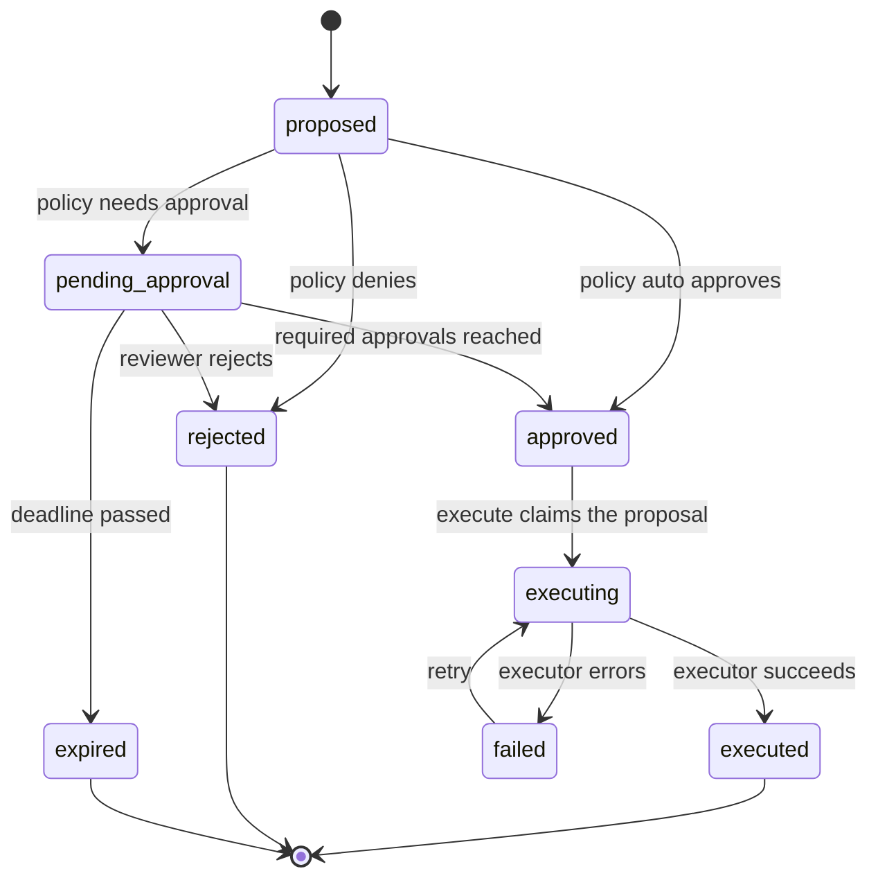
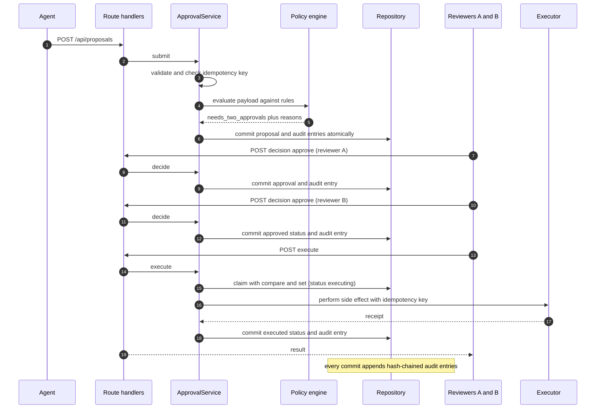

# Agent Approval Console

> An independent demonstration application, written from scratch; not extracted from any production system; all data synthetic. Implemented with AI coding agents (Claude Code).

A human-in-the-loop **approval gate** for side-effecting actions proposed by AI agents, with a **tamper-evident audit trail**. Next.js (App Router) + TypeScript (strict) + Tailwind, with a framework-free, fully unit-tested domain core.

The scenario is the support desk of a fictional outdoor-gear retailer, "Larkspur Trail Supply". Support agents (simulated; there is no language model anywhere in this repo) propose refunds, account credits, customer replies and shipping-address changes. A risk policy decides what may proceed on its own, what needs one human approval, what needs two distinct approvers, and what is denied outright. Nothing happens until it is approved, and every step is recorded in a hash-chained log.

## The problem

An agent that can only *talk* is easy to supervise. An agent that can *act* (move money, send mail, change records) needs a control point between "the model decided" and "the system did it". Without one you get the usual failure modes: a hallucinated refund amount that nobody sees until the ledger is wrong; a double-click that pays twice; an agent approving its own work; an approval given for one payload and silently applied to another; and, afterwards, no trustworthy answer to "who allowed that, and on what basis?"

This project is a small, concrete implementation of that control point: **propose, evaluate, approve, execute, audit**, as separate steps with separate guarantees.

## What it demonstrates

- **Action proposals** with typed payloads, the agent's stated rationale, the originating ticket and a client-supplied idempotency key, validated by custom validators (no schema library) that return every problem with a precise path.
- **A risk policy engine whose rules are data**: outcome is `auto_approve`, `needs_approval`, `needs_two_approvals` or `deny`, each with a machine-readable reason code and a human-readable message. Strictest matching rule wins; no matching rule fails closed.
- **An explicit state machine**: `proposed → pending_approval → approved → executing → executed | failed`, plus `rejected` and `expired`. Illegal transitions throw. Stale pending proposals expire against an injectable clock.
- **Decisions**: approve, reject (reason required), and **edit-then-approve**, which records a field-level diff, re-evaluates policy on the edited payload, and invalidates earlier approvals of the old payload. The proposing agent cannot approve; one reviewer cannot supply both approvals of a two-approver action.
- **Idempotent execution**: a double click, a retry, or eight concurrent requests produce one simulated side effect. Executor failures are recorded and retryable.
- **An append-only audit log with a SHA-256 hash chain** (Node's built-in `crypto`) and a `verifyChain()` that pinpoints the first tampered entry. Refused decisions (for example an agent trying to approve) are audited too.
- **A repository port** with an in-memory implementation seeded with synthetic data, and a documented mapping for a Postgres implementation (not built).

## Architecture

```text
src/
  domain/     pure TypeScript: no React, no Next, no I/O. All the rules live here and are unit-tested.
  server/     thin Next-specific glue: the globalThis store, demo role handling, HTTP helpers.
  app/        App Router pages and route handlers (API).
  components/ UI components (server components by default; client only where interactive).
```

The dependency direction is one way: `app`, `components` and `server` depend on `domain`; `domain` depends on nothing but Node's `crypto`.

### Proposal lifecycle



### Propose, policy, approve, execute, audit



More detail, including the data model and how each guarantee is enforced, is in [`docs/design.md`](docs/design.md).

## Quickstart

Requires Node.js 20.19 or newer (developed on Node 22) and npm.

```bash
npm ci
ENABLE_DEMO_CONTROLS=1 npm run dev          # http://localhost:3000
```

Production build:

```bash
npm run build
ENABLE_DEMO_CONTROLS=1 npm start            # http://localhost:3000
```

`ENABLE_DEMO_CONTROLS=1` switches on the two demo-only endpoints (`/api/demo/reset` and `/api/demo/tamper`, used by the audit page's "Reset" and "Simulate tampering" buttons). Without it they return 403 and the buttons are disabled; everything else works. It is off by default because those endpoints reset or corrupt state.

Quality gates (details under [Development and testing](#development-and-testing)):

```bash
npm run lint
npm run typecheck    # generates Next route types, then runs tsc --noEmit
npm test             # Vitest: domain unit tests and API handler tests
npx playwright install chromium   # once, before the first e2e run
npm run test:e2e     # Playwright (Chromium) against a production build
```

No database or external service is needed, and the only environment variable is the optional demo flag above. State is held **in memory** and is seeded with synthetic data at startup; it **resets whenever the server restarts**. It survives Next.js dev hot reloads because the store is a singleton on `globalThis`.

## Guided tour

1. Open the queue at `http://localhost:3000`. Note the **demo banner** and the role picker ("Acting as"): this is a stand-in for authentication, nothing more. Counts and chips filter by status and by risk.
2. Open a **High risk · 2 approvals** proposal. Read the policy explanation: each reason has a message and a machine-readable code. As Reviewer A, click **Approve**: it stays pending (1 of 2).
3. Click **Approve** again as Reviewer A. The server refuses it: the same reviewer cannot supply both approvals. Switch to **Reviewer B** and approve: now it is approved.
4. Click **Execute (simulated)** (only reviewers and admins can; auto-approved proposals also wait for one of them to execute), then try **Send 2 parallel execute requests** on another approved proposal. The detail page shows the side effect happened once.
5. Open a pending proposal and use **Edit & approve…** to lower an amount. The page shows the field diff and how the policy outcome changed; earlier approvals of the old payload are marked "no longer counts".
6. Switch to **Agent** and try to approve or execute something. The server returns 403 and the refusal appears in the timeline and audit log.
7. Use **Simulate agent** to generate fresh proposals. Try "Refund that fails once downstream": execution fails, the error is recorded, and **Retry execution** succeeds without duplicating the effect.
8. Open **Audit log** (start the server with `ENABLE_DEMO_CONTROLS=1` for this step). Verification shows the chain is valid. Press **Simulate out-of-band tampering** and watch verification fail at the altered entry. **Reset demo data** restores the seed.

## HTTP API

All endpoints return JSON and `Cache-Control: no-store`. **Every `POST` must send `Content-Type: application/json`** (415 otherwise), including bodiless ones such as execute; bodies are capped at 64 KiB counted in bytes (413). Errors look like `{ "error": { "code", "message", "issues?" } }`.

| Method and path | Purpose | Notes |
|---|---|---|
| `GET /api/proposals?status=&risk=&q=` | List and filter; includes counts | `risk` is a policy outcome |
| `POST /api/proposals` | Submit a proposal as an agent | 201 new, 200 if the idempotency key was already used with the same content, 409 if reused with different content |
| `GET /api/proposals/:id` | Proposal plus its timeline | |
| `POST /api/proposals/:id/decision` | `{ "decision": "approve" \| "reject" \| "edit_approve", ... }` | Needs a demo role (401 without one). Reviewer and admin only (403 for `agent`). Each decision accepts only its own fields: `payload` only with `edit_approve`, `reason` only with `reject` (422 otherwise) |
| `POST /api/proposals/:id/execute` | Execute an approved proposal | Reviewer and admin only: `agent` gets 403 and the refusal is audited; no role gets 401. Idempotent; `performed` is true only for the call that ran the executor |
| `GET /api/audit` | Audit entries and chain verification | |
| `POST /api/simulate` | Synthetic agent submits a proposal | `{ "scenario": "random" \| id }` |
| `POST /api/role`, `GET /api/role` | Demo role cookie | Demo only |
| `POST /api/demo/tamper`, `POST /api/demo/reset` | Demo controls | Demo only; 403 unless the server was started with `ENABLE_DEMO_CONTROLS=1` |

Example session (server running on port 3000). Endpoints that act as a person take the demo role from an `x-demo-role` header (or the `demo_role` cookie):

```bash
BASE=http://localhost:3000

# An agent proposes a $300 refund. It exceeds $250, so two distinct approvals are required.
curl -s -X POST "$BASE/api/proposals" -H 'content-type: application/json' -d '{
  "type": "issue_refund",
  "payload": { "orderId": "ORD-777002", "amountCents": 30000, "currency": "USD", "reasonCode": "not_as_described" },
  "rationale": "Customer says the jacket leaks; photos attached to the ticket.",
  "ticketId": "TKT-9002",
  "agentId": "agent:returns-assistant",
  "idempotencyKey": "readme-example-0001"
}'

# Use the id from the response (the first new proposal in a fresh server is PR-1013).
ID=PR-1013
curl -s -X POST "$BASE/api/proposals/$ID/decision" -H 'x-demo-role: reviewer_a' -H 'content-type: application/json' -d '{"decision":"approve"}'
curl -s -X POST "$BASE/api/proposals/$ID/decision" -H 'x-demo-role: reviewer_b' -H 'content-type: application/json' -d '{"decision":"approve"}'
curl -s -X POST "$BASE/api/proposals/$ID/execute"  -H 'x-demo-role: reviewer_a' -H 'content-type: application/json'   # performed: true
curl -s -X POST "$BASE/api/proposals/$ID/execute"  -H 'x-demo-role: reviewer_a' -H 'content-type: application/json'   # already_executed, performed: false
curl -s -X POST "$BASE/api/proposals/$ID/execute"  -H 'x-demo-role: agent' -H 'content-type: application/json'        # 403: agents cannot trigger execution
curl -s "$BASE/api/audit"                                                         # verification.valid: true
```

## Default policy

Defined as data in [`src/domain/policy-config.ts`](src/domain/policy-config.ts). The strictest matching rule wins.

| Action | Rule | Outcome |
|---|---|---|
| Refund | up to $50.00 | auto-approve |
| Refund | over $50.00 | one approval |
| Refund | over $250.00 | two distinct approvals |
| Refund | reason code `other` | one approval |
| Account credit | up to $25.00 / over $25.00 / over $100.00 | auto / one / two approvals |
| Customer reply | promises refunds or guarantees; legal or injury wording; asks for passwords, card numbers or one-time codes | one approval |
| Customer reply | none of the above | auto-approve |
| Shipping address | order not yet shipped | one approval |
| Shipping address | order shipped or delivered | **deny** |

## Design tradeoffs

- **Policy as data, not code.** Rules are plain objects (thresholds, field comparisons, regular-expression lists). They can be reviewed in a diff, versioned (`policyVersion` is stamped on every decision and audit entry), validated at load time, and loaded from storage, without touching the engine. The cost is a deliberately small expression language; anything it cannot say needs an engine change, which is the right pressure.
- **A framework-free domain core.** Every rule that matters (policy, state machine, two-approver logic, idempotency, audit chain) lives in `src/domain/` with no import of React or Next. It is testable in milliseconds with a manual clock, and it would survive a framework swap.
- **Idempotency in three layers.** (1) Submission: the same key plus the same content returns the original proposal; the same key with different content is a 409. (2) Claim: `execute` moves `approved → executing` with a compare-and-set on the proposal's version, so of N concurrent callers exactly one wins. (3) Downstream: the executor is handed the idempotency key and a well-behaved API deduplicates on it, covering the window where a call succeeds but its result is lost. The in-memory run proves layers 1 and 2 with concurrent-call tests; layer 3 is only simulated here.
- **Hash-chained audit versus a real WORM store.** The chain makes edits, deletions and reordering in the middle of the log detectable, at no infrastructure cost. It does **not** stop someone with write access from truncating the tail or rewriting the whole chain consistently; for that you need the head hash anchored somewhere the writer cannot alter (object-lock storage, a transparency log, a periodic signed checkpoint). The chain is a tamper-*evidence* mechanism, not tamper-*prevention*.
- **Edit-then-approve re-evaluates policy.** A reviewer who edits a payload is effectively authoring a new proposal. The edited payload is re-run through policy (it can become cheaper, costlier, or denied), approvals given to the old payload stop counting, and only the editor's approval carries over. Identifying fields (order, customer, currency, shipment status) are locked, so an edit cannot retarget the action or dodge a rule.
- **Execution is a separate step.** Approval does not run the side effect. Keeping "decided" and "done" apart is the point of the control, and it is what makes retries and failure recording well-defined.

## Status

| Capability | Status |
|---|---|
| Proposal validation, risk policy engine, state machine, decisions, edit-then-approve, expiry | Implemented and tested |
| Idempotent execution with failure recording and retry (including concurrent calls) | Implemented and tested |
| Hash-chained audit log with `verifyChain()` and tamper detection | Implemented and tested |
| In-memory repository with atomic commit and optimistic concurrency | Implemented and tested |
| Seeded synthetic data and the scenario generator | Implemented and tested |
| UI flows: queue and filters, role switching, approve, two-approver rule, reject, edit-then-approve, execute, audit and tamper detection, simulate | Implemented and covered by Playwright end-to-end tests (Chromium only) |
| Layout at 375px and 320px (no horizontal overflow, 40px minimum touch targets), page titles, landmarks, one `h1` per page | Implemented and covered by Playwright tests |
| Accessibility: axe (WCAG 2.0/2.1 A and AA, best-practice rules) on every page, light and dark, mobile and desktop width; keyboard-only flows; visible focus | Automated checks have no serious or critical violations. Automated rules cover only part of WCAG: no screen-reader or real-device testing was done, and no formal conformance claim is made |
| Route handlers (JSON API): identity (401/400), execution restricted to reviewer and admin (403 for `agent`, audited), JSON content type required (415), 64 KiB byte cap (413), per-decision field rules (422), demo endpoints gated by `ENABLE_DEMO_CONTROLS` | Implemented and covered by 18 Vitest tests that call the handlers directly (no HTTP server, no browser); there is no OpenAPI or contract-test suite |
| Role switcher (agent, reviewer A, reviewer B, admin) | **Demo-only stand-in**: an unverified cookie or header, not authentication |
| "Agent" and its proposals | **Demo-only stand-in**: templates and a seeded random generator; no LLM |
| Executor | **Demo-only stand-in**: records a receipt in memory; calls nothing |
| Out-of-band tamper button and reset | **Demo-only stand-in** |
| Real authentication and authorization (identity, sessions, agent credentials). The rule "reviewers and admins decide and execute; agents cannot" is enforced, but against the unverified demo role | **Conceptual, not implemented** (the role rule itself is implemented and tested) |
| Persistence (Postgres or any database); data survives restart | **Conceptual, not implemented** (see `docs/design.md`) |
| Real executors (payments, email, order system) | **Conceptual, not implemented** |
| External anchoring of the audit head hash / WORM storage | **Conceptual, not implemented** |
| Notifications, SLAs and escalation for pending items | **Conceptual, not implemented** |

## Development and testing

```bash
npm run lint          # ESLint (Next core-web-vitals + TypeScript rules)
npm run typecheck     # next typegen && tsc --noEmit (strict)
npm test              # Vitest: src/domain/__tests__ and src/server/__tests__ (130 tests)
npm run build
npx playwright install chromium   # once
npm run test:e2e      # Playwright e2e (56 tests); builds the app and serves it on port 4317
```

**Unit tests (Vitest), 130 in 8 files** (112 in `src/domain/__tests__`, 18 in `src/server/__tests__`). The domain tests cover the framework-free core: validation, policy rules and thresholds, the state-machine transition matrix, decisions (separation of duties, two distinct approvers, edit-then-approve re-evaluation, approval invalidation), expiry with an injected clock, idempotent and concurrent execution, executor failure and retry, the hash chain and tamper detection, the in-memory repository, the seed data and the scenario generator.

The API tests in `src/server/__tests__/api.test.ts` import the real route handlers and call them with `NextRequest` objects: missing and invalid roles, `agent` refused on execute and decide (existing and unknown ids alike, with only the refusal recorded), reviewer execute, payload refused on approve, 415 for non-JSON content types on every mutating route, 413 for oversized bodies counted in bytes, and the demo-flag gate.

**End-to-end tests (Playwright, Chromium only), 56 tests** live in `e2e/`. `playwright.config.ts` runs `npm run build` and `next start` through `webServer` on port 4317 (override with `E2E_PORT`; set `E2E_SKIP_BUILD=1` to reuse an existing build, as CI does) with `ENABLE_DEMO_CONTROLS=1`, with one worker because all state is in one process's memory; every test first calls `POST /api/demo/reset`, so tests are independent of order. They cover: the seeded queue and filters; role switching and its persistence; a single approval; the two-approver rule; the agent refusal and its audit entry; reject requiring a reason; edit-then-approve with the diff and policy re-evaluation; invalid and unchanged edits; idempotent execution from the UI (two parallel requests, one effect), an agent refused on execute, and failed-execution retry; the audit page, tamper detection and reset; the simulate control; keyboard-only flows (skip link, open, approve, reject, focus moved to the result, no keyboard trap); no horizontal overflow and 40px touch targets at 375px and 320px; per-page titles, `lang`, `h1` and landmarks; axe on every page in light and dark at mobile and desktop widths; and a visible focus indicator.

Install the browser once with `npx playwright install chromium` (CI uses `--with-deps`).

**Not covered by tests:** browsers other than Chromium; screen readers and other assistive technology; real touch devices; visual regression; load and security testing; the real HTTP server stack for the API tests (handlers are called directly); true multi-process or multi-request interleaving of execute (the unit test uses in-process concurrency); hot-reload behaviour of the dev server.

## Limitations

- Everything is in one Node process's memory. Restarting loses all state and re-seeds; running multiple instances would give each its own store.
- The "demo role" is not security. Anyone can claim any role; the API accepts the role from a header or cookie. The approval rules are enforced, but against an identity the client chooses.
- The agent-reported `shipmentStatus` in an address-change payload is trusted by the policy. A real policy should read it from the order system, not from the proposer.
- The policy engine's text rules are keyword patterns. They are a demonstration of rules-as-data, not content moderation, and are easy to evade.
- If a process died between claiming an execution and recording its outcome, the proposal would sit in `executing`. A real system needs a reconciliation job that resolves such claims using the idempotency key.
- Expiry is evaluated lazily whenever the queue, a proposal or the audit log is read or a decision is made; there is no background timer.
- No rate limiting or request signing. CSRF is only partly addressed: mutating routes require `Content-Type: application/json` (which blocks plain cross-site HTML form posts) and the demo cookie is `SameSite=Lax`; there are no CSRF tokens or origin checks.
- Execution is restricted to reviewer and admin roles, so an agent cannot trigger the side effect it proposed. There is no separate system executor: auto-approved proposals also wait until a reviewer or admin executes them. A reviewer may execute a proposal they approved.
- Refused attempts are audited with the caller-supplied proposal id (truncated to 64 characters), so a caller with the `agent` role can add entries to the audit log by repeating forbidden calls; there is no rate limit.
- The audit chain proves integrity of what is stored, not completeness (see the tradeoff above).
- Accessibility is checked with axe and targeted keyboard tests, not with screen readers or user testing. The review panel sits below the proposal details, so on a phone a reviewer scrolls past the payload and policy cards before reaching the buttons.
- The end-to-end suite runs in Chromium only and depends on the seeded demo data (ids `PR-1001` to `PR-1012`) and on the demo reset endpoint, which is why its server runs with `ENABLE_DEMO_CONTROLS=1`.

## License

MIT. See [`LICENSE`](LICENSE).
